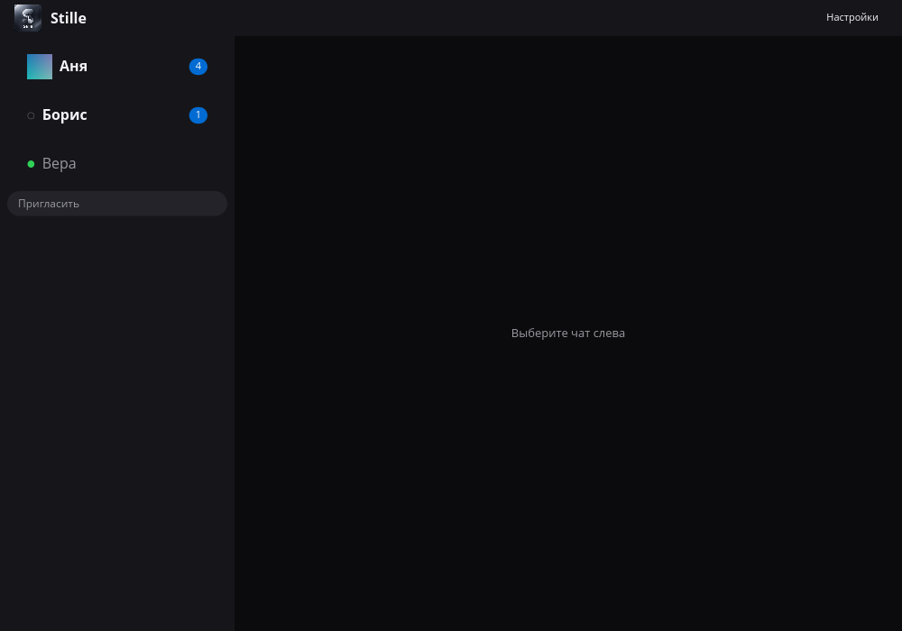

# Stille Messenger

[](https://github.com/EryyynIT/stille-messenger/actions/workflows/ci.yml)

Десктоп-клиент Stille Messenger для [stille-messenger-core](https://github.com/Puxxalwl/shopot-core/) —
серверлесс P2P-движок обмена сообщениями со сквозным шифрованием и forward secrecy.

Собран на [iced](https://github.com/iced-rs/iced) с программным рендером
tiny-skia на Rust: тёмная content-first палитра, один акцентный цвет, честные
статусы отправки, без придуманных квитанций прочтения и presence.



## Статус

Опубликованный релиз: **v0.1.1**. Возможности ниже описывают текущий
`main`, а не содержимое старого релизного архива. Текущий main работает
с реальным демоном `stille-messenger-core serve` по бинарному кадровому API 2.2.0
через Unix-сокет (`$HOME/.stille-messenger/api.sock`); `--mock` включает демо-сцену
без ядра.

Текущий клиент поддерживает историю, поиск, звонки, разметку, реакции, файлы
и аватарки. Семантика их восстановления и persistence следует API ядра;
память GUI не является вторым хранилищем.

Уже сделано:

- типизированный канал ядра: кодек бинарных кадров, корреляция ответов,
  события, реконнект с ресинком; e2e-тест гоняет инвайт → сообщение → ACK
  доставки против двух реальных демонов (гейт по `STILLE_MESSENGER_BIN`, старое `SHOPOT_BIN` поддерживается)
- знакомство: одноразовые коды приглашений с QR, добавление по чужому коду;
  LAN, адресные и relay-коды
- список контактов с точками presence и бейджами непрочитанных
- лента с разделителями дней, системными событиями и честными статусами
  (отправляю → отправлено / отправится позже; доставлено только после
  сопоставленного core ID; не ушло); компактный режим ленты
- история и API-gated поиск, закрепы, визитки и удаление чата
- разметка, реакции, файлы, аватарки и звонки
- карточка контакта и меню по правой кнопке с блокировкой/разблокировкой;
  Esc закрывает обычные диалоги, но не активный звонок
- уведомления ОС через `notify-send`; тело сообщения скрыто по умолчанию,
  но имя контакта передаётся во внешний заголовок, а файловое уведомление
  сейчас включает имя/размер; открытый в фокусе чат не уведомляет
- панель настроек: приватность текста уведомлений, компактная лента,
  масштаб шрифта (80–150%)
- управление с клавиатуры: Ctrl+1..9 — чат по номеру в списке, Ctrl+Q —
  выход, Esc закрывает обычные диалоги
- композер с авторостом и кнопкой отправки
- headless UI-тесты (`iced_test`) и юнит-тесты; CI гоняет fmt, clippy,
  тесты, release-сборку и cargo-deny на каждый пуш

Текущие пределы: хронологическое окно истории не больше 200 сообщений;
scroll anchors поиска/закрепов и ответы на сообщения не реализованы.
Настройки и drafts живут в сессии; реакции не восстанавливаются из истории.
GUI не пишет контент сообщений и контактов на диск и в логи. Это не
гарантирует отсутствие истории уведомлений ОС. Пользовательский прогон
двух машин, качество живого двустороннего голоса и полная accessibility
приёмка остаются открытыми.

### Источник дизайн-принципов

Desktop-контракт адаптирует content-first иерархию, явные состояния и
проверку измерениями из [Stille UI design (EN)](https://github.com/Puxxalwl/Stille-Messenger-Android/blob/main/docs/UI-DESIGN.md)
и [RU](https://github.com/Puxxalwl/Stille-Messenger-Android/blob/main/ru/UI-DESIGN.md).
Код Android, bottom tabs, swipe-only навигация, Back, ripple, 48dp и
motion-blur не копируются. Stille сохраняет непрозрачные поверхности и
sidebar/conversation layout. Ссылка фиксирует происхождение идей, а не
создаёт второй guideline или разрешает новые зависимости.

## Скачивание

Релизы — один архив с клиентом, демоном и скриптом запуска для Linux x86_64,
без тулчейнов:

```sh
tar -xzf stille-messenger-v0.1.1-x86_64-linux-gnu.tar.gz
cd stille-messenger && ./run.sh
```

`run.sh` при первом запуске создаёт личность, поднимает демона в фоне и
открывает клиент. Сборка из исходников — ниже.

Локальные прототипы AppImage/Flatpak проходят проверку в ходе rename; это не
артефакты удалённого релиза. Для AppImage нужен `appimagetool`, для Flatpak —
`flatpak-builder` и runtime Freedesktop 24.08:

```sh
scripts/build_appimage.sh dev
flatpak-builder --user --install build-flatpak \
  packaging/flatpak/io.github.stille_messenger.yaml
```

Идентификаторы упаковки используют бренд Stille; локальные прототипы пока не
входят в удалённый release workflow.

## Сборка и запуск

Нужны стабильный Rust и [Zig 0.17.0](https://ziglang.org/) для демона.

```sh
# движок: собрать, создать личность, запустить демона
cd core/zig && zig build -Doptimize=ReleaseSafe && cd ../..
./core/zig/zig-out/bin/stille-messenger-core init
./core/zig/zig-out/bin/stille-messenger-core serve

# клиент, в другом терминале
cargo run --release
```

Чтобы познакомиться, нажмите «Пригласить» в сайдбаре и «Выдать код» в
диалоге: вы получите одноразовый код с QR — передайте его вне канала. Чтобы
добавить контакт, вставьте чужой код в «Вставить чужой код» и нажмите
«Добавить»; чат откроется, как только демон узнает обе стороны. Правая кнопка
по контакту — заблокировать/разблокировать; Esc закрывает обычные диалоги.

Реализованные shortcuts: Ctrl+1..9 открывает чат по номеру в списке, Ctrl+Q
выходит, Esc закрывает обычные диалоги (не активный звонок). Полная
стрелочная/Tab-навигация и приёмка видимого focus ring ещё не завершены.
Входящие приходят уведомлением ОС (`notify-send`) с именем отправителя; тело
сообщения скрыто по умолчанию, пока вы не разрешите его в «Настройках».
Файловые уведомления сейчас включают имя/размер независимо от этой настройки.
Кнопка в шапке окна, там же компактная лента и масштаб шрифта.

Знакомство через интернет (разные сети, разные города): код без адреса
работает только внутри одной локальной сети. Демон при старте пишет
«слушаю 0.0.0.0:PORT» — пробросьте этот порт на роутере, затем впишите свой
публичный `host:port` в поле «Адрес» перед выдачей: демон собеседника
дозвонится напрямую. Галка «через relay» пускает
соединение через сервер `stille-messenger-core relay`, чтобы собеседник не увидел ваш IP;
на закреплённой сборке демона этот путь экспериментальный — надёжный сейчас
вариант: код с адресом.

## Ядро

Stille — это клиент; движок — шифрованный P2P-транспорт, сессии,
хранилище — в [stille-messenger-core](https://github.com/Puxxalwl/shopot-core)
от [puxxalwl](https://github.com/puxxalwl). Зафиксированный контракт API —
подмодуль `core` (спецификация бинарного протокола:
`core/zig/docs/CORE-API.md`).

## Лицензия

[MIT](LICENSE)
